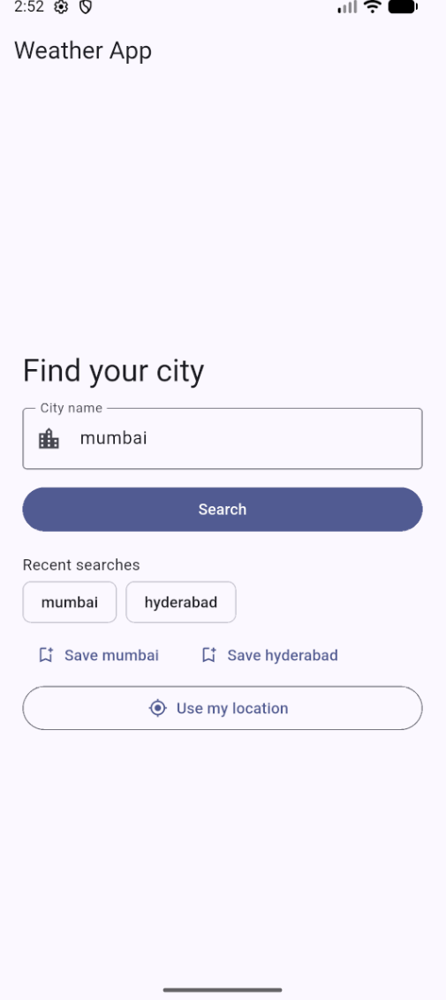
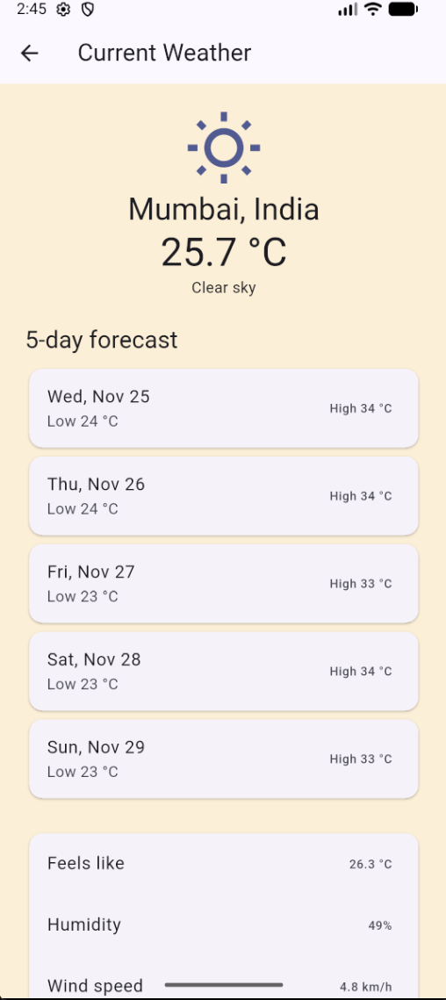
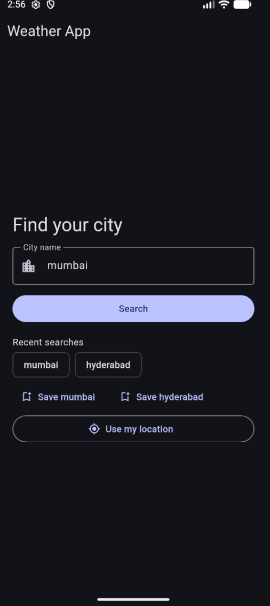
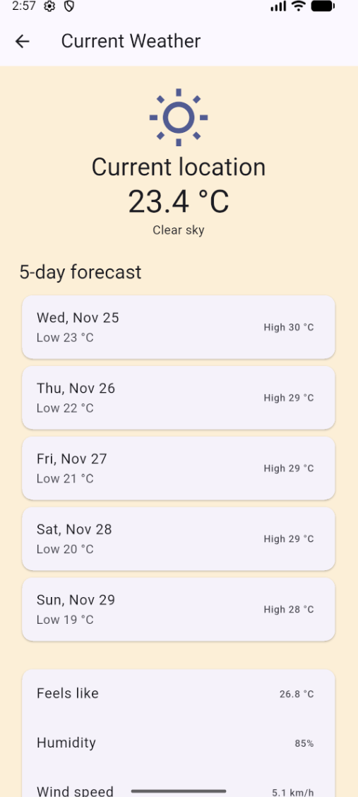

# Weather App

A Flutter app for checking current weather and a five-day forecast by city name or by using your device location.

## Features

- Search for a city and see its current temperature, weather condition, feels-like temperature, humidity, and wind speed.
- View daily highs and lows in a five-day forecast.
- Reopen recent searches and save favorite cities for quick access.
- Use your current location to get a forecast.
- View weather-based backgrounds, dark mode, and an animated transition to the forecast.
- See clear messages when a city is unavailable or the internet connection fails.

## Weather data

[Open-Meteo](https://open-meteo.com/) provides the weather data. Its Geocoding API turns city names into coordinates, and its Forecast API returns the current conditions and daily forecast. No API key is required.

## Run locally

Install Flutter and start an Android emulator or connect an Android device. Open a terminal in the project folder and run:

```bash
flutter pub get
flutter run
```

Allow location access when prompted if you tap **Use my location**.

## Screenshots

| Home screen | Mumbai forecast |
| --- | --- |
|  |  |

| Dark mode | Current location |
| --- | --- |
|  |  |